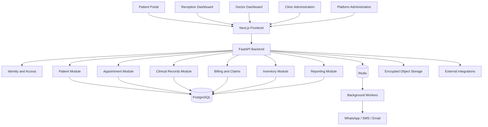

# CLINICFLOW
## Product Requirements, Architecture & Implementation Blueprint

**Product:** ClinicFlow  
**Category:** Healthcare Practice Management System (HPMS)  
**Initial market:** Swakopmund and Walvis Bay, Erongo Region, Namibia  
**Expansion market:** Nationwide Namibia  
**Currency:** Namibian Dollar (NAD)  
**Commercial models:** Subscription and once-off installation with maintenance  
**Platform:** Responsive web application, desktop and mobile  
**Product positioning:** One connected operational platform for independent healthcare professionals, private practices and multi-branch clinics.

---

# 1. Executive Summary

ClinicFlow is a configurable healthcare management platform designed to help healthcare providers manage their complete practice operations.

It will bring patient registration, appointment scheduling, electronic medical records, consultations, prescriptions, billing, medical aid administration, laboratory workflows, inventory, staff management and reporting into one system.

The platform will support different healthcare disciplines without forcing every clinic to use the same workflow.

Examples:

- General practitioners need consultations, patient histories and prescriptions.
- Dentists need treatment plans, dental procedures and recurring appointments.
- Physiotherapists need treatment sessions, progress notes and rehabilitation plans.
- Specialist practices need referrals, clinical documentation and follow-ups.
- Multi-doctor clinics need shared scheduling, reception, billing and reporting.

ClinicFlow must support both single-practitioner practices and multi-branch healthcare organisations.

## Product objectives

1. Reduce administrative work at reception.
2. Improve patient appointment access.
3. Centralise patient information and medical records.
4. Improve consultation documentation.
5. Streamline invoicing and medical aid administration.
6. Reduce missed appointments through reminders.
7. Give clinic owners operational and financial visibility.
8. Support secure collaboration between authorised healthcare professionals.
9. Provide a platform that can grow from one practice to multiple branches.
10. Generate recurring software revenue while supporting once-off enterprise installations.

# 2. Target Market

## 2.1 Customer segments

| Segment | Typical requirements |
|---|---|
| Independent doctor | Patient records, appointments, consultations, billing |
| General practice | Multiple doctors, reception, patient records, billing |
| Dental practice | Dental charts, treatment plans, procedure scheduling |
| Physiotherapy | Treatment sessions, rehabilitation plans, progress tracking |
| Specialist practice | Referrals, consultation history, follow-ups |
| Medical centre | Multiple departments, doctors and shared resources |
| Multi-branch clinic | Central administration and branch-level reporting |
| Occupational health clinic | Employer accounts, occupational assessments and restricted records |

## 2.2 User roles

- Platform Super Administrator
- Organisation Owner
- Organisation Administrator
- Branch Manager
- Receptionist
- Doctor / Medical Practitioner
- Dentist
- Physiotherapist
- Nurse
- Practice Manager
- Medical Billing Officer
- Pharmacist or authorised dispensary user
- Laboratory Technician
- Patient
- Auditor / Read-only Compliance User

Permissions must be configurable by organisation and branch.

A receptionist must not automatically have access to confidential clinical notes. A billing officer must not automatically have access to a complete medical history.

# 3. Functional Product Requirements

## Module 1: Organisation and Clinic Management

The system must support multiple independent healthcare organisations.

Requirements:

- Register a clinic or medical practice.
- Configure organisation details and contact information.
- Create multiple branches.
- Assign staff to one or more branches.
- Configure clinic operating hours.
- Configure consultation types and fees.
- Configure appointment durations.
- Define departments and specialties.
- Configure currencies, initially NAD.
- Configure tax and invoice settings according to applicable requirements.
- Manage organisation subscription or licence.
- Configure organisation branding.

Each organisation must have isolated patient, financial and operational data.

## Module 2: Patient Management

Provide a central patient register.

Patient registration fields:

- Patient number (automatically generated).
- First name and surname.
- Date of birth.
- Sex, where clinically required.
- Nationality, where relevant.
- Contact number.
- Email address.
- Physical address.
- Emergency contact.
- Preferred communication channel.
- Medical aid membership details.
- Medical aid principal member.
- Membership number.
- Patient consent records.
- Patient account status.

Features:

- Search and filter patients.
- Detect potential duplicate patients.
- Merge duplicate records through an authorised workflow.
- View patient appointment history.
- View authorised medical history.
- Upload supporting documents.
- Record patient communication preferences.
- Record guardian and dependent relationships.
- Export patient information subject to access permissions.
- Record patient requests for access to information.

A patient must have one organisation-specific identifier. Cross-clinic identity sharing must not happen automatically.

## Module 3: Appointment and Scheduling Management

This is one of the most important modules.

Features:

- Daily, weekly and monthly calendar.
- Doctor availability.
- Branch availability.
- Consultation duration.
- Appointment types.
- Online patient booking.
- Receptionist-created appointments.
- Walk-in registration.
- Rescheduling.
- Cancellation.
- Recurring appointments.
- Waiting lists.
- Follow-up appointments.
- Appointment confirmation.
- Appointment reminders.
- No-show tracking.
- Doctor leave and unavailable periods.
- Room and equipment allocation.

Appointment statuses:

- Requested
- Pending confirmation
- Confirmed
- Checked in
- Waiting
- In consultation
- Completed
- Cancelled
- No-show

Business rules:

- Prevent overlapping appointments for the same provider.
- Support configurable booking buffers.
- Prevent booking outside provider availability.
- Allow authorised staff to override scheduling restrictions.
- Record all appointment changes.
- Support appointment cancellation policies.
- Prevent duplicate bookings caused by simultaneous requests.

## Module 4: Patient Self-Service Portal

A mobile-first patient experience.

Features:

- Patient account registration.
- Secure login.
- Search available doctors.
- Filter by specialty and branch.
- View appointment availability.
- Book appointments.
- Cancel or reschedule appointments.
- Receive booking confirmation.
- View upcoming appointments.
- View appointment history.
- Submit administrative enquiries.
- Update permitted personal details.
- Upload referral documents.
- Download available invoices and receipts.
- Request copies of records through an authorised process.

Patients must not be able to access another patient's information by changing URLs or identifiers.

The booking interface should also support patients who do not want to create an account, subject to configurable verification requirements.

## Module 5: Reception and Queue Management

Reception dashboard:

- Today's appointments.
- Walk-in patients.
- Expected arrivals.
- Checked-in patients.
- Waiting patients.
- Doctors currently available.
- Delayed appointments.
- Outstanding balances.
- New patient registrations.

Queue management:

1. Patient arrives.
2. Reception confirms identity.
3. Patient is checked in.
4. Patient joins the appropriate queue.
5. Doctor is notified.
6. Patient is called into consultation.
7. Consultation status is updated.

Provide configurable queue categories for general practice, dental, physiotherapy and specialist services.

## Module 6: Electronic Medical Records (EMR)

This is a high-priority module but must be implemented with strong clinical and security controls.

Patient clinical record:

- Medical history.
- Current complaints.
- Allergies.
- Existing conditions.
- Medication history.
- Vital signs.
- Clinical notes.
- Diagnoses.
- Treatment plans.
- Procedures.
- Referrals.
- Laboratory results.
- Follow-up instructions.
- Uploaded medical documents.

Consultation workflow:

1. Open patient record.
2. Verify patient identity.
3. Review relevant history.
4. Record clinical observations.
5. Document assessment.
6. Record diagnosis where applicable.
7. Record treatment plan.
8. Create prescription or referral if authorised.
9. Save and sign the clinical record.
10. Close consultation.

Clinical notes must support draft, signed and amended states.

Signed clinical records must not be silently overwritten. Corrections must preserve the original record and maintain an amendment history.

## Module 7: Specialty-Specific Clinical Workflows

Use a configurable core EMR with optional specialty modules.

### General Practice

- Consultation notes.
- Medical history.
- Vital signs.
- Diagnosis records.
- Medication records.
- Follow-up plans.
- Referral management.

### Dental Practice

- Interactive dental chart.
- Tooth numbering.
- Dental conditions.
- Treatment plans.
- Procedure history.
- Dental appointment types.
- Dental treatment quotations.
- Before-and-after document attachments.

### Physiotherapy

- Initial assessment.
- Functional assessment.
- Treatment plans.
- Session records.
- Progress measurements.
- Rehabilitation exercises.
- Follow-up scheduling.

### Specialist Practice

- Referral information.
- Specialist consultation notes.
- Investigation history.
- Follow-up plans.
- Supporting documents.

The core system must not become dependent on one specialty's data structure.

## Module 8: Prescriptions and Medication Management

Features:

- Medication catalogue.
- Generic and brand names.
- Strength and dosage information.
- Prescription creation.
- Prescription history.
- Prescriber identification.
- Prescription status.
- Medication administration records where applicable.
- Allergy warnings.
- Drug interaction warning integration where a validated source is available.
- Printable prescription documents.

Only appropriately authorised practitioners may issue prescriptions.

Do not implement autonomous AI diagnosis or prescribing.

Electronic prescribing and pharmacy integrations must be reviewed against Namibian professional and medicines requirements before production deployment.

## Module 9: Laboratory and Diagnostic Management

Features:

- Create laboratory requests.
- Select test categories.
- Record specimen collection.
- Track request status.
- Receive laboratory results.
- Upload external laboratory reports.
- Associate results with patient records.
- Notify authorised practitioners of new results.
- Track outstanding investigations.

Statuses:

- Requested
- Collected
- Sent
- Processing
- Completed
- Reviewed
- Cancelled

Initial implementation can use secure manual result uploads and structured data entry.

Direct laboratory integration should be added through dedicated integration adapters.

## Module 10: Billing and Invoicing

Features:

- Consultation fees.
- Procedure charges.
- Service catalogues.
- Invoice generation.
- Invoice numbering.
- Invoice adjustments.
- Credit notes.
- Receipts.
- Partial payments.
- Outstanding balances.
- Refund recording.
- Cash and electronic payment tracking.
- Patient statements.
- Daily cash-up.
- Revenue reporting.

Payment methods should be configurable, including cash, bank transfer, card and supported electronic payment providers.

Never store raw payment card details.

Financial records must have an audit trail. Paid invoices should not be silently edited.

## Module 11: Medical Aid Administration

This module is commercially important in Namibia.

Features:

- Medical aid fund records.
- Member information.
- Dependant information.
- Membership verification records.
- Benefit and authorisation notes.
- Patient co-payment calculations.
- Claim preparation.
- Claim references.
- Claim submission tracking.
- Rejection reasons.
- Remittance records.
- Reconciliation.
- Outstanding claim reports.

Claim statuses:

- Draft
- Ready for submission
- Submitted
- Processing
- Accepted
- Rejected
- Partially paid
- Paid
- Resubmission required

Important integration boundary:

ClinicFlow must initially support medical aid administration and claim preparation. Direct electronic claim submission, eligibility verification and remittance integration must only be advertised as supported once provider agreements, technical specifications and authorisation have been obtained.

## Module 12: Inventory and Stock Management

Optional modules for clinics that hold medicines, consumables or medical supplies.

Features:

- Product catalogue.
- Stock categories.
- Suppliers.
- Purchase orders.
- Goods received.
- Stock adjustments.
- Stock transfers.
- Batch numbers.
- Expiry dates.
- Reorder levels.
- Stock counts.
- Usage history.
- Stock valuation.

Where medicine dispensing is enabled, apply appropriate authorisation, traceability and regulatory controls.

## Module 13: Staff and Human Resources

Features:

- Staff profiles.
- Professional details.
- Role assignment.
- Branch assignment.
- Work schedules.
- Leave records.
- Provider availability.
- Staff access suspension.
- Professional registration and licence expiry reminders.
- Training document records.
- Audit history.

The platform must support verification of professional credentials. It must not assume that a registered person automatically has a current licence to practise.

## Module 14: Notifications

Supported channels:

- WhatsApp Business Platform.
- SMS.
- Email.
- In-app notifications.

Notification events:

- Appointment requested.
- Appointment confirmed.
- Appointment reminder.
- Appointment cancelled.
- Appointment rescheduled.
- Follow-up reminder.
- Payment receipt.
- Outstanding invoice reminder.
- Laboratory result available for authorised review.
- Staff licence expiry reminder.

Patients must be able to configure permitted communication preferences.

Do not include diagnoses, prescriptions or sensitive medical information in ordinary SMS or WhatsApp reminders.

## Module 15: Reporting and Analytics

Operational reports:

- Appointments per day.
- Appointment cancellations.
- No-show rates.
- Doctor utilisation.
- Patient registrations.
- Average waiting time.
- Consultation volumes.
- Branch performance.

Financial reports:

- Daily revenue.
- Monthly revenue.
- Outstanding invoices.
- Payments received.
- Medical aid claims outstanding.
- Claim rejection rates.
- Revenue by provider.
- Revenue by service.

Clinical and operational reports must be permission-controlled and de-identified where appropriate.

## Module 16: Platform Administration

Platform owner dashboard:

- Registered organisations.
- Active subscriptions.
- Trial accounts.
- Expired licences.
- Active branches.
- User counts.
- System health.
- Storage usage.
- Integration health.
- Support requests.
- Billing and subscription status.

The platform administrator must not automatically receive access to patient clinical records.

Access to customer data for support must be explicitly authorised, time-limited and audited.

# 4. Non-Functional Requirements

## Performance

- Target normal dashboard response under 2 seconds.
- Target common database queries under 500 ms.
- Support concurrent booking requests.
- Use pagination for large lists.
- Use background processing for notifications and reports.

These are initial engineering targets and must be load-tested.

## Availability

- Target 99.5% monthly application availability initially.
- Automated backups.
- Documented restoration procedure.
- Monitoring and alerting.
- Graceful handling of external service failures.

## Mobile responsiveness

- Mobile-first patient portal.
- Responsive doctor dashboard.
- Desktop-optimised reception and administration.
- Touch-friendly appointment calendar.
- Low-bandwidth friendly interfaces.
- Avoid large unnecessary downloads.

## Accessibility

- Keyboard navigation.
- Clear form labels.
- Adequate contrast.
- Screen-reader-friendly controls.
- Accessible validation and error messages.

# 5. Technical Architecture

## Recommended technology stack

| Layer | Technology |
|---|---|
| Frontend | Next.js + TypeScript |
| UI components | shadcn/ui + Radix UI |
| Styling | CSS variables + Tailwind CSS |
| Backend | Python FastAPI |
| Database | PostgreSQL 16+ |
| ORM | SQLAlchemy |
| Migrations | Alembic |
| Authentication | OpenID Connect / Keycloak |
| Background jobs | Celery |
| Queue and cache | Redis |
| File storage | S3-compatible object storage |
| API | REST + OpenAPI |
| Notifications | WhatsApp Business API, SMS and email providers |
| Containerisation | Docker |
| Reverse proxy | Caddy or Nginx |
| Monitoring | OpenTelemetry + error monitoring |
| Testing | Pytest + Playwright |

## Architecture style

Start with a **modular monolith**, not microservices.

This keeps the first version easier to build, test, deploy and maintain. Modules should have clear boundaries so they can be extracted later if scale requires it.

## High-level architecture



## Backend module structure

```text
backend/
├── app/
│   ├── main.py
│   ├── core/
│   │   ├── config.py
│   │   ├── security.py
│   │   ├── permissions.py
│   │   ├── tenancy.py
│   │   ├── audit.py
│   │   └── exceptions.py
│   │
│   ├── modules/
│   │   ├── organisations/
│   │   ├── branches/
│   │   ├── users/
│   │   ├── staff/
│   │   ├── patients/
│   │   ├── appointments/
│   │   ├── queues/
│   │   ├── encounters/
│   │   ├── clinical_records/
│   │   ├── prescriptions/
│   │   ├── laboratory/
│   │   ├── referrals/
│   │   ├── billing/
│   │   ├── medical_aid/
│   │   ├── inventory/
│   │   ├── notifications/
│   │   ├── reports/
│   │   └── subscriptions/
│   │
│   ├── integrations/
│   │   ├── messaging/
│   │   ├── payments/
│   │   ├── medical_aid/
│   │   ├── laboratories/
│   │   └── interoperability/
│   │
│   ├── tasks/
│   └── shared/
│
├── migrations/
├── tests/
├── Dockerfile
└── pyproject.toml
```

## Frontend structure

```text
frontend/
├── app/
│   ├── (public)/
│   ├── (patient)/
│   ├── (reception)/
│   ├── (doctor)/
│   ├── (clinic-admin)/
│   └── (platform-admin)/
│
├── components/
│   ├── ui/
│   ├── calendar/
│   ├── patients/
│   ├── clinical/
│   ├── billing/
│   └── dashboard/
│
├── features/
├── hooks/
├── lib/
├── services/
└── types/
```

# 6. Database Design

## Database principles

- PostgreSQL relational database.
- UUID primary keys.
- Organisation-level data isolation.
- Branch-level permissions.
- Foreign-key constraints.
- Created and updated timestamps.
- Soft deletion only where appropriate.
- Immutable audit events.
- Database transactions for billing and bookings.
- Explicit clinical record versioning.
- Encrypted sensitive data where appropriate.

Every organisation-owned business table should contain an `organisation_id`.

Tables that are branch-specific should also contain `branch_id` where appropriate.

Use PostgreSQL Row-Level Security as defence in depth. Never rely only on frontend filtering to protect tenant data.

## 6.1 Organisation and access tables

### organisations

| Column | Type |
|---|---|
| id | UUID PK |
| name | VARCHAR |
| legal_name | VARCHAR |
| registration_number | VARCHAR |
| email | VARCHAR |
| phone | VARCHAR |
| currency | CHAR(3) |
| timezone | VARCHAR |
| status | VARCHAR |
| created_at | TIMESTAMPTZ |

### branches

| Column | Type |
|---|---|
| id | UUID PK |
| organisation_id | UUID FK |
| name | VARCHAR |
| branch_code | VARCHAR |
| address | TEXT |
| phone | VARCHAR |
| email | VARCHAR |
| operating_hours | JSONB |
| is_active | BOOLEAN |

### users

| Column | Type |
|---|---|
| id | UUID PK |
| identity_provider_id | VARCHAR UNIQUE |
| email | VARCHAR |
| phone | VARCHAR |
| full_name | VARCHAR |
| status | VARCHAR |
| last_login_at | TIMESTAMPTZ |
| created_at | TIMESTAMPTZ |

### organisation_memberships

| Column | Type |
|---|---|
| id | UUID PK |
| organisation_id | UUID FK |
| user_id | UUID FK |
| role_id | UUID FK |
| branch_id | UUID FK nullable |
| status | VARCHAR |

### roles

- id
- organisation_id
- name
- description

### permissions

- id
- code
- description

### role_permissions

- role_id
- permission_id

### staff_profiles

- id
- organisation_id
- user_id
- professional_number
- profession
- specialty
- registration_status
- licence_expiry_date
- employment_status

Professional registration and licence details should be verified before enabling clinical permissions.

## 6.2 Patient tables

### patients

| Column | Type |
|---|---|
| id | UUID PK |
| organisation_id | UUID FK |
| patient_number | VARCHAR |
| first_name | VARCHAR |
| last_name | VARCHAR |
| date_of_birth | DATE |
| sex | VARCHAR nullable |
| phone | VARCHAR |
| email | VARCHAR |
| address | TEXT |
| emergency_contact | JSONB |
| status | VARCHAR |
| created_at | TIMESTAMPTZ |

Unique constraint: `(organisation_id, patient_number)`.

### patient_contacts

- id
- patient_id
- contact_type
- name
- phone
- relationship
- is_emergency_contact

### patient_guardians

- id
- patient_id
- guardian_patient_id nullable
- guardian_name
- relationship
- authority_document_id
- valid_from
- valid_until

### patient_consents

- id
- patient_id
- consent_type
- purpose
- consent_status
- captured_at
- captured_by
- withdrawn_at
- consent_document_id

### medical_aid_memberships

- id
- patient_id
- fund_id
- membership_number
- principal_member
- dependant_code
- effective_from
- effective_until
- verification_status

## 6.3 Scheduling tables

### providers

- id
- organisation_id
- staff_profile_id
- specialty_id
- consultation_duration
- booking_enabled
- status

### specialties

- id
- organisation_id
- name
- description

### provider_availability

- id
- provider_id
- branch_id
- weekday
- start_time
- end_time
- effective_from
- effective_until

### provider_unavailability

- id
- provider_id
- start_at
- end_at
- reason

### appointment_types

- id
- organisation_id
- name
- duration_minutes
- fee
- deposit_required
- booking_buffer_minutes

### appointments

| Column | Type |
|---|---|
| id | UUID PK |
| organisation_id | UUID FK |
| branch_id | UUID FK |
| patient_id | UUID FK |
| provider_id | UUID FK |
| appointment_type_id | UUID FK |
| start_at | TIMESTAMPTZ |
| end_at | TIMESTAMPTZ |
| status | VARCHAR |
| booking_source | VARCHAR |
| cancellation_reason | TEXT |
| created_by | UUID FK |
| created_at | TIMESTAMPTZ |

Add database-level protection against conflicting provider appointments, with appropriate handling for permitted statuses and overrides.

### appointment_events

- id
- appointment_id
- previous_status
- new_status
- event_type
- actor_user_id
- reason
- created_at

### clinic_rooms

- id
- organisation_id
- branch_id
- name
- room_type
- status

## 6.4 Queue tables

### queue_entries

- id
- organisation_id
- branch_id
- appointment_id nullable
- patient_id
- provider_id nullable
- queue_number
- priority
- status
- checked_in_at
- called_at
- completed_at

## 6.5 Clinical records

### encounters

| Column | Type |
|---|---|
| id | UUID PK |
| organisation_id | UUID FK |
| branch_id | UUID FK |
| patient_id | UUID FK |
| provider_id | UUID FK |
| appointment_id | UUID FK nullable |
| encounter_type | VARCHAR |
| status | VARCHAR |
| started_at | TIMESTAMPTZ |
| ended_at | TIMESTAMPTZ |

### clinical_notes

- id
- encounter_id
- author_id
- note_type
- content
- version_number
- status
- signed_at
- created_at

### diagnoses

- id
- organisation_id
- patient_id
- encounter_id
- code_system
- diagnosis_code
- description
- clinical_status
- recorded_by

### allergies

- id
- patient_id
- substance
- reaction
- severity
- status
- recorded_by

### observations

- id
- encounter_id
- patient_id
- observation_type
- value
- unit
- measured_at
- recorded_by

### medication_catalogue

- id
- organisation_id nullable
- name
- generic_name
- strength
- dosage_form
- active_ingredient
- status

### prescriptions

- id
- organisation_id
- patient_id
- encounter_id
- prescriber_id
- prescription_number
- status
- issued_at

### prescription_items

- id
- prescription_id
- medication_id
- dosage
- frequency
- route
- duration
- quantity
- instructions

### referrals

- id
- patient_id
- encounter_id
- referring_provider_id
- receiving_provider
- reason
- status
- created_at

## 6.6 Laboratory tables

### laboratory_orders

- id
- organisation_id
- patient_id
- encounter_id
- requesting_provider_id
- laboratory_id
- status
- requested_at

### laboratory_order_items

- id
- laboratory_order_id
- test_code
- test_name
- specimen_type
- status

### laboratory_results

- id
- laboratory_order_item_id
- result_value
- unit
- reference_range
- interpretation
- result_document_id
- verified_by
- verified_at

## 6.7 Billing and finance

### service_catalogue

- id
- organisation_id
- code
- name
- description
- unit_price
- tax_category
- is_active

### invoices

| Column | Type |
|---|---|
| id | UUID PK |
| organisation_id | UUID FK |
| branch_id | UUID FK |
| patient_id | UUID FK |
| invoice_number | VARCHAR |
| subtotal | NUMERIC(12,2) |
| tax_amount | NUMERIC(12,2) |
| total | NUMERIC(12,2) |
| amount_paid | NUMERIC(12,2) |
| status | VARCHAR |
| issued_at | TIMESTAMPTZ |
| due_at | TIMESTAMPTZ |

### invoice_items

- id
- invoice_id
- service_id
- description
- quantity
- unit_price
- tax_amount
- line_total

### payments

- id
- organisation_id
- invoice_id
- payment_reference
- amount
- currency
- payment_method
- status
- received_at
- received_by

### credit_notes

- id
- organisation_id
- invoice_id
- credit_note_number
- reason
- amount
- issued_at
- issued_by

### medical_aid_funds

- id
- organisation_id
- fund_name
- administrator
- contact_details
- integration_status

### medical_aid_claims

- id
- organisation_id
- patient_id
- invoice_id
- fund_id
- claim_reference
- submitted_amount
- approved_amount
- paid_amount
- status
- submitted_at
- response_at

### claim_events

- id
- claim_id
- event_type
- event_reference
- message
- created_at

## 6.8 Inventory tables

### inventory_items

- id
- organisation_id
- sku
- name
- category
- unit_of_measure
- reorder_level
- is_active

### suppliers

- id
- organisation_id
- name
- contact_details
- address

### stock_batches

- id
- inventory_item_id
- branch_id
- batch_number
- expiry_date
- quantity_received
- quantity_remaining

### stock_movements

- id
- inventory_item_id
- branch_id
- batch_id
- movement_type
- quantity
- reference
- performed_by
- created_at

### purchase_orders

- id
- organisation_id
- supplier_id
- branch_id
- order_number
- status
- total_amount
- created_at

## 6.9 Documents, communications and auditing

### documents

- id
- organisation_id
- patient_id nullable
- document_type
- storage_key
- original_filename
- mime_type
- file_size
- uploaded_by
- created_at

### notification_templates

- id
- organisation_id
- channel
- event_type
- template_content
- status

### notifications

- id
- organisation_id
- patient_id nullable
- recipient
- channel
- event_type
- delivery_status
- provider_reference
- sent_at

### audit_logs

- id
- organisation_id
- actor_user_id
- action
- resource_type
- resource_id
- branch_id
- timestamp
- request_id
- source_ip
- metadata

Audit events must be append-only and protected from ordinary application-user modification.

### subscriptions

- id
- organisation_id
- plan_id
- status
- billing_cycle
- starts_at
- expires_at

### licences

- id
- organisation_id
- licence_type
- installation_identifier
- issued_at
- expires_at
- maintenance_status

## 6.10 Important database constraints

- Unique patient number per organisation.
- Unique invoice number per organisation.
- Unique prescription number per organisation.
- Unique appointment reference.
- Foreign-key integrity across clinical records.
- Prevent negative inventory quantities unless explicitly authorised.
- Prevent invalid invoice status transitions.
- Prevent unauthorised clinical record changes.
- Prevent overlapping provider bookings.
- Prevent tenant-crossing queries.
- Use transactions for invoices, payments and claims.

# 7. Security and Privacy Architecture

Healthcare data requires stronger safeguards than ordinary business software.

## Authentication

- Secure authentication.
- Multi-factor authentication for privileged users.
- Session expiry.
- Account lockout and suspicious-login monitoring.
- Password reset verification.
- Role-based access control.
- Branch-level restrictions.

## Data protection

- HTTPS everywhere.
- Encryption at rest.
- Encrypted database backups.
- Private document storage.
- Short-lived signed download URLs.
- Secrets outside source code.
- Database access restricted to application services.
- Separate production and development environments.
- No real patient data in development or testing.
- Secure deletion and retention workflows.
- Audit trails for clinical information access.

## Clinical integrity

- Signed clinical records cannot be silently overwritten.
- Amendments preserve original content.
- Prescription creation and cancellation are auditable.
- Patient identity must be confirmed before disclosure.
- Access to sensitive records must be justified and logged.
- Emergency or break-glass access must be restricted, reasoned and audited.

## Namibia-specific compliance

Before production use, obtain legal and professional review covering:

- Health Professions Act 2024.
- Hospitals and Health Facilities Act.
- Professional confidentiality and ethical obligations.
- Medical record retention.
- Patient consent and disclosure.
- Medicines and prescription requirements.
- Applicable electronic transactions and cybersecurity obligations.
- Cross-border processing and hosting.
- Future or newly enacted data-protection requirements.

Namibia's Digital Health Policy 2026–2036 identifies interoperability, NAMIF and NAM-X as important directions. Design the integration layer to accommodate these standards, but do not claim an integration or certification until formally verified.

# 8. Interoperability and External Integrations

Design an integration framework from the beginning.

Potential integrations:

| Integration | Initial implementation |
|---|---|
| WhatsApp | Appointment reminders and confirmations |
| SMS | Notifications and OTP |
| Email | Receipts and administrative communications |
| Payment providers | Payment status and reconciliation |
| Medical aid administrators | Claims and eligibility adapters |
| Laboratories | Result exchange |
| Pharmacies | Prescription exchange where authorised |
| Accounting systems | Financial exports |
| National digital health infrastructure | Future standards-based integration |

Use HL7 FHIR as a future interoperability target, with a mapping layer between internal data models and relevant FHIR resources.

Do not make direct integration a dependency for the first release.

# 9. User Interface and Design Direction

> **Superseded for implementation by [`docs/DESIGN.md`](DESIGN.md).** In particular, typography changed from Manrope/Inter to IBM Plex Sans + IBM Plex Mono, and the palette gained AA-compliant text variants.

## Product identity

**ClinicFlow — Healthcare, organised.**

Design must feel like professional healthcare software, not a generic CRM or an AI-generated dashboard.

## Visual direction

Suggested palette:

| Purpose | Colour |
|---|---|
| Primary | Deep medical teal `#126B67` |
| Secondary | Muted blue `#527F9B` |
| Success | `#26856B` |
| Background | `#F5F8F8` |
| Surface | `#FFFFFF` |
| Main text | `#203334` |
| Secondary text | `#687C7D` |
| Warning | `#D69A38` |
| Danger | `#C64E4E` |

Typography:

- Headings: Manrope
- Body: Inter
- Data and references: IBM Plex Mono

Design principles:

- Light theme as default.
- Restrained use of colour.
- No unnecessary gradients.
- Clear clinical status indicators.
- Consistent spacing and typography.
- Compact information-dense desktop tables.
- Mobile-friendly patient portal.
- Accessible contrast.
- Consistent Lucide icons.
- Avoid excessive cards and decorative dashboard widgets.

## Main dashboards

### Reception

- Appointment calendar.
- Waiting queue.
- Check-in controls.
- Patient search.
- Outstanding balances.
- Doctor availability.

### Doctor

- Today's consultations.
- Patient history.
- Encounter documentation.
- Prescriptions.
- Referrals.
- Follow-ups.

### Clinic Administrator

- Revenue overview.
- Appointment performance.
- Doctor utilisation.
- Staff management.
- Branch performance.
- Medical aid claims.

### Patient

- Upcoming appointments.
- Book a consultation.
- Reschedule.
- Appointment history.
- Invoices and receipts.
- Personal details.

# 10. Commercial Model

ClinicFlow must support two separate commercial offerings.

## Model A: Subscription

Illustrative launch pricing to validate with clinics:

| Plan | Monthly price | Target |
|---|---:|---|
| Solo | N$450 | Independent practitioner |
| Practice | N$850 | Small clinic |
| Professional | N$1,500 | Multi-doctor clinic |
| Enterprise | Custom | Multi-branch organisation |

Possible features by tier:

**Solo**
- One provider.
- Patient register.
- Appointments.
- Basic clinical records.
- Invoicing.

**Practice**
- Multiple providers.
- Reception dashboard.
- Patient portal.
- Notifications.
- Clinical records.
- Reporting.

**Professional**
- Advanced billing.
- Medical aid workflows.
- Laboratory workflows.
- Inventory.
- Advanced reports.

**Enterprise**
- Multiple branches.
- Central administration.
- Custom workflows.
- Dedicated support.
- Integration services.

## Model B: Once-off Installation + Maintenance

The customer purchases an installation licence.

Illustrative commercial structure:

- Initial installation and configuration.
- Data migration.
- Staff training.
- Custom branding.
- Hosting setup.
- Optional integrations.
- Annual maintenance agreement.
- Technical support agreement.

For on-premises deployments, the clinic is responsible for approved hardware, physical security and agreed backup arrangements. Offer managed hosting as a separate service.

Do not promise lifetime support or unlimited custom development under a once-off licence.

## Additional revenue

- Data migration.
- Staff training.
- Custom reports.
- Integration development.
- Additional branches.
- Dedicated hosting.
- Premium support.
- SMS and WhatsApp usage.

# 11. Implementation Roadmap

A realistic initial programme is approximately 20–24 weeks, depending on the development team, pilot feedback and integration complexity.

## Phase 0 — Customer Discovery (Weeks 1–2)

Objectives:

- Interview at least five healthcare practices.
- Interview receptionists and healthcare professionals.
- Document existing booking workflows.
- Understand medical aid processes.
- Identify current software and pain points.
- Establish record migration requirements.
- Validate willingness to pay.

Deliverables:

- Customer interview report.
- Workflow diagrams.
- Prioritised requirements.
- Pilot clinic candidate.
- Product acceptance criteria.

## Phase 1 — Platform Foundation (Weeks 3–5)

Build:

- Organisation registration.
- Multi-tenancy.
- Branch management.
- Authentication.
- User management.
- Roles and permissions.
- Audit logging.
- Basic settings.

Acceptance criteria:

- Two independent organisations can use the system.
- Their data remains isolated.
- Permissions are enforced by the backend.
- Audit events are generated for sensitive operations.

## Phase 2 — Patient and Scheduling (Weeks 6–8)

Build:

- Patient registration.
- Patient search.
- Doctor profiles.
- Provider availability.
- Appointment types.
- Calendar.
- Booking engine.
- Rescheduling.
- Cancellation.
- Reception dashboard.

Acceptance criteria:

- Patients can be registered.
- Receptionists can book appointments.
- Conflicting appointments are prevented.
- Appointment changes are audited.

## Phase 3 — Patient Portal and Notifications (Weeks 9–10)

Build:

- Patient login.
- Online booking.
- Appointment history.
- Rescheduling.
- Confirmation messages.
- Reminder worker.
- Notification delivery tracking.

Acceptance criteria:

- Patient can book without receptionist assistance.
- Duplicate bookings are prevented.
- Failed notifications can be retried.
- Sensitive clinical data is not exposed in messages.

## Phase 4 — Clinical Records (Weeks 11–14)

Build:

- Encounters.
- Clinical notes.
- Medical history.
- Allergies.
- Observations.
- Diagnoses.
- Referrals.
- Prescription records.
- Clinical document uploads.
- Record signing and amendment workflows.

Acceptance criteria:

- An authorised practitioner can complete a consultation.
- Signed records cannot be silently modified.
- Access to clinical records is permission-controlled and logged.

## Phase 5 — Billing and Medical Aid (Weeks 15–17)

Build:

- Service catalogue.
- Invoices.
- Invoice items.
- Payments.
- Receipts.
- Credit notes.
- Patient statements.
- Medical aid fund records.
- Claim preparation.
- Claim tracking.

Acceptance criteria:

- A consultation can generate an invoice.
- Payments are correctly reconciled.
- Claim statuses are tracked.
- Financial history remains auditable.

## Phase 6 — Specialty and Operational Modules (Weeks 18–20)

Build:

- Dental workflows.
- Physiotherapy workflows.
- Laboratory management.
- Inventory.
- Staff scheduling.
- Advanced reporting.

Prioritise modules according to the first pilot clinic's actual requirements.

## Phase 7 — Security, Testing and Pilot (Weeks 21–22)

Complete:

- Security testing.
- Permission testing.
- Tenant isolation tests.
- Backup restoration tests.
- Performance tests.
- Data migration rehearsal.
- User acceptance testing.
- Staff training.
- Pilot deployment.

## Phase 8 — Commercial Launch (Weeks 23–24)

- Resolve pilot issues.
- Finalise pricing.
- Prepare onboarding documentation.
- Prepare support procedures.
- Create customer contracts.
- Establish service-level targets.
- Begin sales to additional practices.

# 12. Testing Strategy

## Backend tests

- Authentication.
- Permissions.
- Tenant isolation.
- Appointment scheduling.
- Booking conflicts.
- Clinical record signing.
- Invoice calculations.
- Payment reconciliation.
- Claim status transitions.
- Audit logging.

## Frontend tests

- Patient registration.
- Online booking.
- Reception check-in.
- Doctor consultation.
- Invoice creation.
- Patient portal access.
- Responsive layouts.

## Security tests

- Cross-tenant access attempts.
- Broken access control.
- IDOR vulnerabilities.
- Session management.
- File access restrictions.
- SQL injection.
- XSS.
- CSRF where applicable.
- Backup security.
- Privilege escalation.

## Pilot acceptance

Do not launch until:

- Patient data is isolated.
- Clinical permissions work correctly.
- Appointment booking is reliable.
- Billing calculations are correct.
- Backups can be restored.
- Staff understand the system.
- The clinic approves the migrated data.
- Critical security issues are resolved.

# 13. Deployment Architecture

## Development

Docker Compose:

- frontend
- backend
- PostgreSQL
- Redis
- background worker
- object storage service
- reverse proxy

## Production

Recommended:

- Linux cloud server or managed infrastructure.
- Managed PostgreSQL or secured dedicated database.
- Private object storage.
- HTTPS.
- Centralised logs.
- Error monitoring.
- Automated encrypted backups.
- Separate staging and production.
- Infrastructure monitoring.
- Documented disaster recovery.

Support two deployment modes:

**Managed cloud:** Multi-tenant SaaS operated by ClinicFlow.

**Dedicated installation:** Dedicated environment for a customer, with separately agreed hosting, maintenance and support.

# 14. Key Product Risks

| Risk | Mitigation |
|---|---|
| Sensitive health data exposure | Strong access controls, encryption and audits |
| Poor clinic adoption | Pilot with real reception and clinical workflows |
| Medical aid integration delays | Start with manual claim preparation and tracking |
| Data migration errors | Rehearsal, validation and clinic sign-off |
| Complex specialty workflows | Modular specialty extensions |
| Internet interruptions | Resilient UX, retry queues and documented fallback procedures |
| Scope expansion | Strict MVP and release prioritisation |
| Regulatory changes | Regular legal and professional review |
| Customisation becoming expensive | Configurable workflows and paid custom development |

# 15. Success Metrics

Initial pilot targets:

- At least 80% of appointments captured in ClinicFlow.
- Reduction in receptionist time spent managing bookings.
- Reduction in missed appointments.
- Accurate patient identification.
- No unresolved critical access-control vulnerabilities.
- Successful backup restoration.
- High staff adoption after training.
- Successful reconciliation of test invoices and payments.
- First paying customer converted to a sustainable commercial agreement.

Measure actual baseline performance before claiming improvements.

# 16. Recommended MVP Scope

The first commercial release should include:

1. Organisation and branch management.
2. User roles and permissions.
3. Patient management.
4. Doctor management.
5. Appointment scheduling.
6. Patient self-service booking.
7. Reception queue management.
8. Electronic medical records.
9. Consultation documentation.
10. Basic prescriptions.
11. Invoicing and payments.
12. Appointment reminders.
13. Operational reporting.
14. Audit logs.
15. Backup and recovery.

Defer advanced pharmacy, laboratory integrations, electronic claims submission, complex hospital workflows and AI clinical features until the core product is stable and validated.

# 17. Final Product Strategy

ClinicFlow should not compete by being the cheapest appointment-booking website.

It should compete by offering a connected operational platform that independent clinics can afford, configure and grow with.

The commercial strategy:

- Start with independent practices and small multi-doctor clinics.
- Secure one pilot in Swakopmund or Walvis Bay.
- Build around real reception and practitioner workflows.
- Demonstrate the patient booking and billing experience.
- Offer subscription and dedicated installation packages.
- Expand into specialist and multi-branch practices.
- Introduce advanced integrations after establishing customer demand.

**Final product positioning:**

ClinicFlow is a complete healthcare practice management platform that connects patients, practitioners, reception, clinical records and clinic administration in one secure system.

**The first milestone is not building every module. It is securing a pilot clinic and proving that ClinicFlow can reliably manage its daily operations.**
